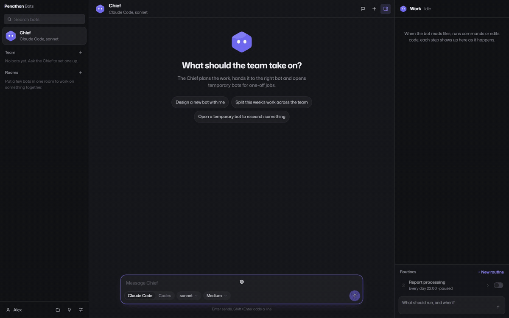

# Penathon Bots

Turn Claude Code and Codex into a team of persistent AI teammates. Open source, local-first, free.

[](LICENSE)


<!-- Demo GIF will be added at docs/media/demo.gif:

-->

## Why

- Run Claude Code and Codex side by side, with the engine and model that fit each teammate's work.
- Build your team by talking to the Chief bot: describe a role, review its proposal, and approve it.
- Keep your team and history local: SQLite on your machine, no server to deploy, no Docker.

## Features

- **Bots & Chief:** persistent Markdown bot definitions, custom avatars and personalities, per-bot memory, streaming conversations, history search, and a protected Chief that creates and coordinates teammates. Delegate to existing bots or spin up temporary helpers.
- **Projects & folder permissions:** group one or more folders into a project and grant each bot Reader, Writer, or Full access. Reader is intended for reading; Writer allows edits and requests approval for deletion; Full allows deletion without approval. Enforcement differs by engine; see [Privacy & safety](#privacy--safety).
- **Routines & reports:** daily, weekly, or interval schedules in your computer's local time, manual runs, run history, and work reports to the Chief. The Chief can process reports into an optional knowledge folder or an authorized project's notes. Routines run while the app is running, including in the tray; missed runs are not replayed after quitting.
- **Rooms, group chat & handoff:** put several bots in one room, call a teammate with `@Name`, and let bots hand off to other members. The room lead answers when nobody is mentioned.
- **Connections:** allow connections per bot. Claude discovers claude.ai connectors and user/project MCP servers; Codex uses MCP servers from its own configuration. The Connections overview manages Claude connections; Codex bots use their bot editor's connection selection.
- **Telegram bridge:** connect your own Telegram bot, pair one private chat with a code, route messages to a selected teammate, answer approval cards, and optionally receive routine results. The app polls Telegram; no public webhook server is needed.
- **Desktop UI:** Turkish and English interface, dark/light/system themes, tray operation, and configurable desktop notifications.

## Download

Get an installer from [GitHub Releases](https://github.com/barancaki/penathon-bots/releases).

**Windows:** the installer is unsigned. If SmartScreen appears, choose **More info → Run anyway** after verifying that you downloaded the release you intended to install.

**macOS:** builds are for Apple Silicon (arm64) only, unsigned and not notarized. Intel Mac users can build from source on an Intel Mac. Move the app to Applications, then right-click it and choose **Open**. If macOS still blocks a trusted download, remove its quarantine attribute:

```sh
xattr -dr com.apple.quarantine "/Applications/Penathon Bots.app"
```

## Requirements & sign-in

Use **your own Claude Code or Codex CLI sign-in**, or choose API-key authentication and save your key in Settings. You only need to connect the engine you want to use; the SDKs bundle their executables and reuse local CLI account state. Model availability and authentication are verified when you send a message.

API keys saved in Settings are encrypted through Electron `safeStorage`, using the operating system's protected secret storage (Keychain on macOS). Saving secrets fails if secure OS encryption is unavailable. Existing CLI credentials remain managed by the CLI.

Penathon Bots is free software. Model-provider usage may require a paid account or incur API charges; access depends on your account and provider policies. You are responsible for complying with Anthropic's and OpenAI's terms for your account.

## Quick start: your first five minutes

1. **Install and open** Penathon Bots.
2. **Connect an engine** in Settings: use your existing CLI sign-in or save an API key. Choose that engine for the Chief and send a first message to check access.
3. **Ask the Chief to create your first bot.** For example: “Create a documentation teammate that keeps my project notes up to date.” Review the bot card, adjust it if needed, and approve it.
4. **Give it a project folder.** Open Projects, add a folder such as your Acme Website repository, and grant the bot Reader or Writer access. You can also ask the Chief to propose a project and access grant for approval.
5. **Set a routine.** Tell the bot: “Every weekday at 09:00, review the project notes and summarize what needs updating.” Review and approve the routine card. Keep the app running for scheduled work.

## Privacy & safety

Team definitions, settings, memory, conversation history, room messages, routine history, and reports are stored on your machine in the app's data directory. There is no Penathon-hosted backend required to run the app. History and bot files are not encrypted by the app; protect your computer and backups accordingly.

When you use a bot, its prompts, instructions, relevant history/memory, and file or tool results used for the task are sent to its model provider. Enabled connections communicate with their services, and the optional Telegram bridge sends messages and results through Telegram. Local-first does not mean offline model inference. SDKs and CLIs may also keep their own local transcripts.

The app shows approval cards for agent-proposed permanent bot creation/edits, routine changes/deletion, project creation, and project access changes. Temporary helpers, delegation, and running an existing routine do not require those approvals. Claude intercepts recognized connector actions such as sending/publishing and file deletions outside Full-access folders for approval; these checks do not cover every possible external action.

Folder controls have practical limits:

- Claude checks file-tool paths against allowed folders. Restricted Claude bots cannot run Bash on Windows; Full sandbox access enables it.
- Codex uses its SDK sandbox and writable-directory controls. Its read scopes and knowledge-folder exclusions are advisory instructions, and Writer deletion approval is also an instruction: the SDK cannot pause those file operations for an app approval. External Codex MCP tools are not intercepted by the app's connector-action approval checks.
- Full sandbox access (`danger-full-access`) disables OS sandboxing. These controls are not a substitute for OS-level isolation when handling untrusted code or sensitive data.

Use narrow folder and connection grants, and review approval cards before accepting them.

## Build from source

Requires **Node.js 22.22+** and npm. Dependencies and the lockfile are pinned.

```sh
npm ci
npm run dev
```

For renderer-only development with the mock API:

```sh
npm run dev:ui
```

Run the same checks as CI:

```sh
npm run typecheck
npm run lint
npm test
npm run build
```

Tests run offline in Node with mocked engine SDKs and Electron APIs. Some tests exercise a real loopback HTTP server, but they do not need a desktop display or provider credentials. CI runs these checks on Linux, Windows, and macOS; it does not run the smoke test.

`npm run smoke` is an optional integration check that **uses real accounts/tokens** and sends one short prompt to each engine. It is excluded from the normal tests and build, but TypeScript checks the script. It uses local CLI login and a read-only bot. Optional environment variables: `PENATHON_SMOKE_WORKDIR`, `PENATHON_SMOKE_CLAUDE_MODEL`, and `PENATHON_SMOKE_CODEX_MODEL`.

After building, run the separate offline desktop check on a machine with a graphical session:

```sh
node_modules/.bin/electron scripts/check-desktop.mjs
```

It uses `.tmp/`, checks real `safeStorage` encryption and sandboxed preload IPC, and never starts either engine. Remove `ELECTRON_RUN_AS_NODE` from the environment when launching Electron as a desktop app.

To package installers on the corresponding operating system:

```sh
npm run dist:win
npm run dist:mac
```

The Windows target is NSIS. The macOS target is an unsigned DMG for Apple Silicon (arm64) only, with signing explicitly disabled. Intel Mac users can build from source on an Intel Mac. Installer artifacts go in `release/`; packaging may download Electron or packaging tools.

## Architecture

- `src/shared`: Zod schemas for bots, settings, projects, routines, and rooms; engine-independent events; IPC contracts; shared translations.
- `src/main`: Markdown bot storage/watcher, versioned SQLite repository, chat lifecycle, team tools and approvals, projects, routine scheduling, rooms, notifications, Telegram, and Claude/Codex SDK adapters.
- `src/preload`: explicit `window.api` methods and unsubscribable event listeners. No generic IPC or Node API is exposed to the renderer.
- `src/renderer`: React UI, bot/project editors, chat and room views, approval cards, routines/reports, connections, settings, and Turkish/English UI strings. Business logic stays in main.
- `tests` and `scripts`: offline Vitest checks, icon generation, and opt-in engine/desktop integration checks.

Electron uses context isolation, a sandboxed CommonJS preload, disabled Node integration, validated IPC, restricted navigation, and a production Content Security Policy. Codex's team tools use an authenticated, run-scoped HTTP MCP server bound to loopback; nothing needs to be deployed.

### Local files and sessions

Settings live in `userData/settings.json`; saved API keys and the Telegram token are encrypted in `secrets.json`. Keys are never returned after saving, and known secrets are redacted from app messages/events before SQLite or IPC. Credentials are passed to SDK subprocesses in memory/environment.

The defaults are `userData/bots` for bot definitions and `userData/workspace` for work. Settings can select a different bots directory and an optional knowledge folder. Changing the bots directory selects/seeds the new directory without moving the old files.

Bots are Markdown files with validated YAML frontmatter. External valid edits are watched; invalid edits retain the last valid bot. The Chief's ID/system protection is permanent, and deleting its file restores it. Malformed Chief files stop startup without being overwritten. Temporary bot definitions also persist until removed or made permanent.

SQLite uses `node:sqlite`, versioned migrations, WAL, and transactions. Interrupted runs are marked on startup. Changing engine/model starts a fresh SDK session; earlier messages remain visible without being imported into the new engine's context.

### SDK boundaries

Claude uses `query()`, appended system instructions, effort controls, and session resume. Codex uses streamed threads, resume, reasoning effort, and sandbox settings; instructions precede prompts because its SDK has no system-instruction field. Model suggestions come from local defaults/caches, and custom model IDs are supported.

Claude structured file patches produce unified diff events. Codex file-change events contain paths/kinds only, so they produce file-write tool rows. Token counts are shown when available. Claude costs are SDK estimates and may include resumed-session totals; Codex provides no cost figure.

## Contributing

See [CONTRIBUTING.md](CONTRIBUTING.md) for setup, checks, and the pull-request workflow. Participation follows our [Code of Conduct](CODE_OF_CONDUCT.md). Report vulnerabilities privately as described in [SECURITY.md](SECURITY.md).

## License

Penathon Bots is licensed under the [Apache License 2.0](LICENSE). Third-party dependencies retain their own licenses and terms. The **Penathon** name and logo are trademarks of Penathon and are not licensed under Apache-2.0; see [NOTICE](NOTICE).

Built by [Penathon](https://penathon.co) — we build AI automation for businesses.
